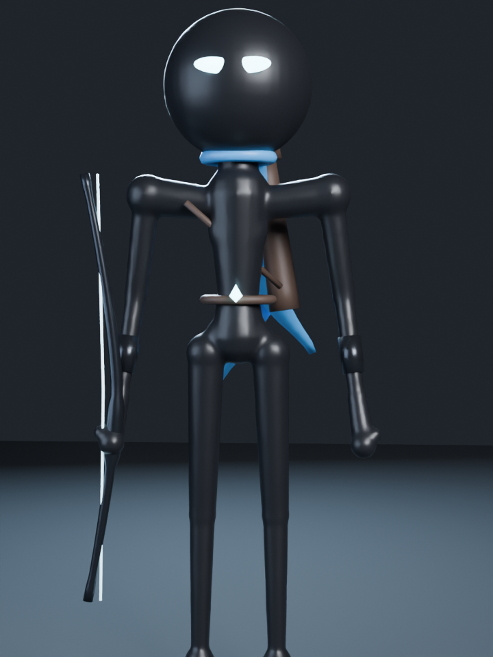
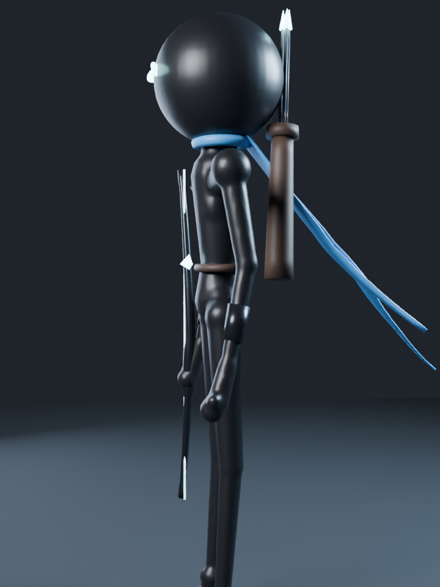
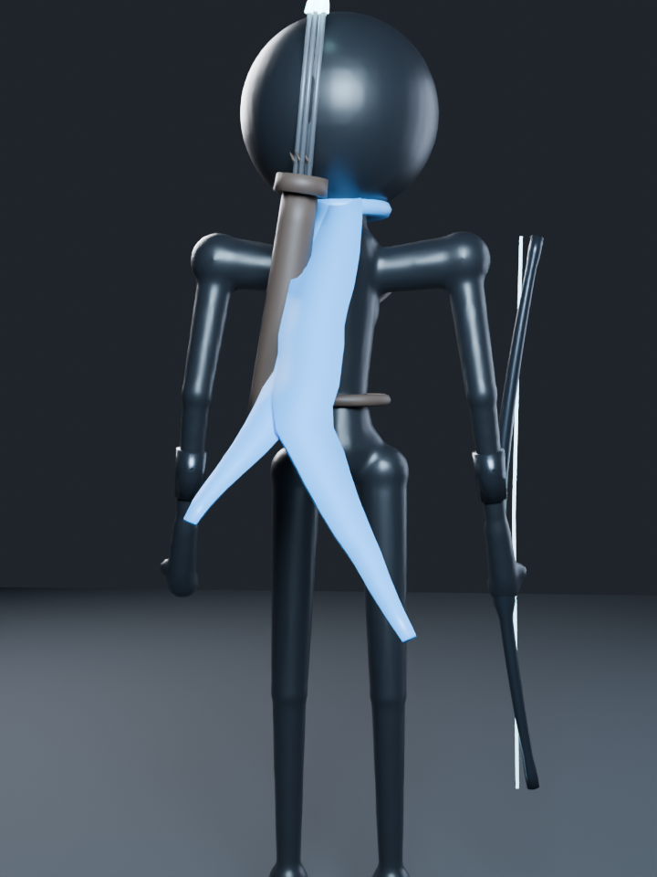
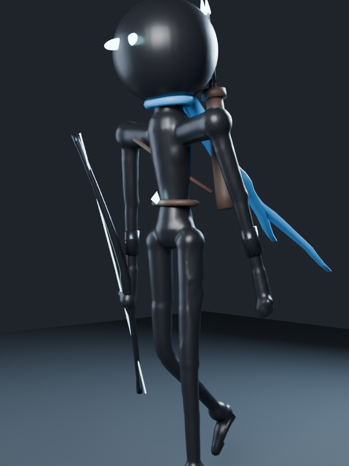
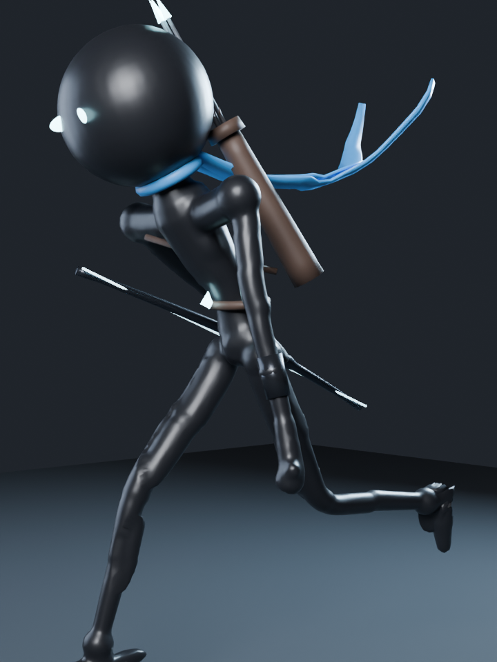
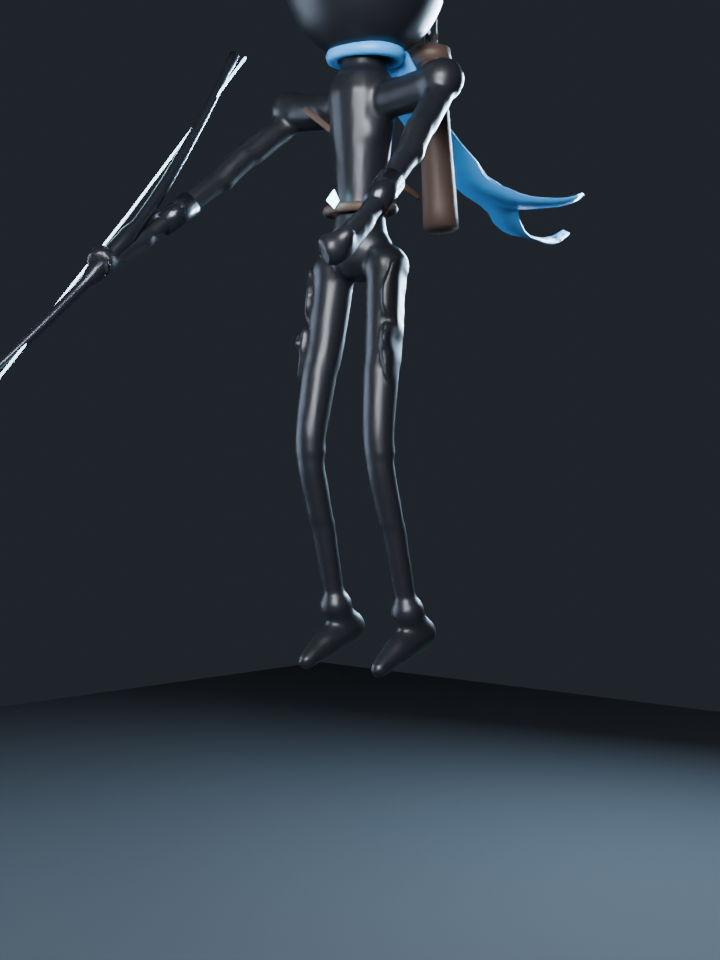

# Stickman Archer

Skinned stickman archer for a side-view strategy game. One fused body, a deforming scarf, bow in the left hand, quiver, and four game clips. Built in Blender and exported as glTF.



| Front | Side | Back |
|---|---|---|
|  |  |  |

| Walk | Run | Jump |
|---|---|---|
|  |  |  |

## Files

| File | What it is |
|---|---|
| [models/StickmanArcher.glb](models/StickmanArcher.glb) | Default blue archer. Skinned mesh, 30 joints, Idle / Walk / Run / Jump |
| [models/variants/](models/variants) | Same rig and clips, scarf and glow recolored: Blue, Red, Gold, Green, Violet |
| [tools/build_archer.py](tools/build_archer.py) | Blender 4.2 script that rebuilds the mesh, weights, clips, and GLBs |
| [previews/](previews) | Cycles stills used to check silhouette and motion |

`Assets/Scripts` is an older 2D Unity sketch. It is not connected to this GLB.

## Model

- Meters, Y-up. Faces −Y. About 1.68 m tall. Feet rest on the ground.
- Body is one manifold mesh (voxel-remeshed capsules), not separate cubes. Scarf, bow, quiver, belt, gem, bracers, and eyes are extra skinned meshes.
- 30 deform joints: spine chain, arms, legs, and two scarf tails of five bones each.
- Materials are solid PBR. Eyes, gem, and arrow tips emit. No texture maps.
- Color is a separate GLB per variant, not `KHR_materials_variants`. Drop the file you want in the engine.

## Clips

| Clip | Length | Loop |
|---|---|---|
| Idle | 4.0 s | yes |
| Walk | 1.0 s | yes |
| Run | 0.67 s | yes |
| Jump | 2.17 s | no |

Walk and Run stay in place. Jump moves the armature root up (crouch, hop, land). Set looping in the engine. The clips are NLA tracks inside the GLB.

## Use

Blender: File → Import → glTF 2.0. The Dope Sheet lists Idle, Walk, Run, Jump.

Unity (glTFast): import the GLB, put an Animator on the root, and mark Idle, Walk, and Run as Loop Time.

Godot 4: the import creates an `AnimationPlayer` with the four clips.

Three.js:

```js
const gltf = await loader.loadAsync("./models/StickmanArcher.glb");
const mixer = new THREE.AnimationMixer(gltf.scene);
mixer.clipAction(gltf.animations.find((c) => c.name === "Walk")).play();
```

## Rebuild

Needs Blender 4.2 on `PATH`.

```bash
blender --background --python tools/build_archer.py
```

GLBs and, with `-- --render`, the preview PNGs are written to `build/`. Copy `build/StickmanArcher.glb` to `models/` and the `StickmanArcher_*.glb` files to `models/variants/`.
